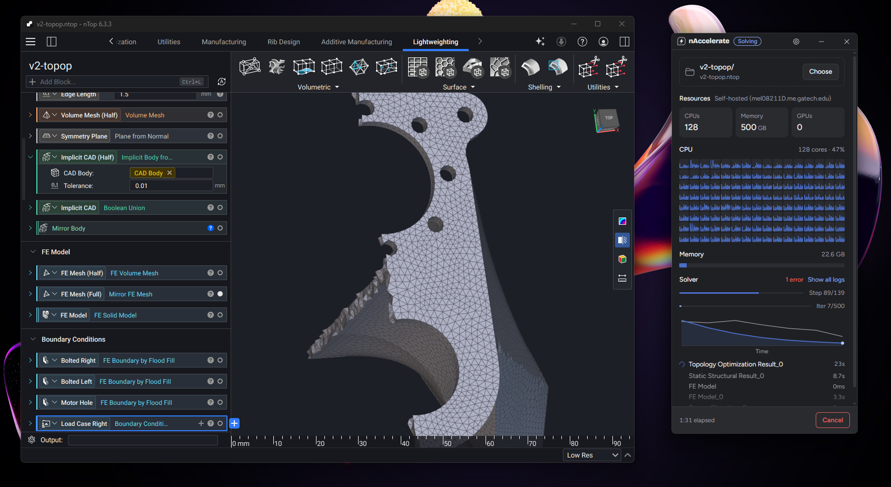
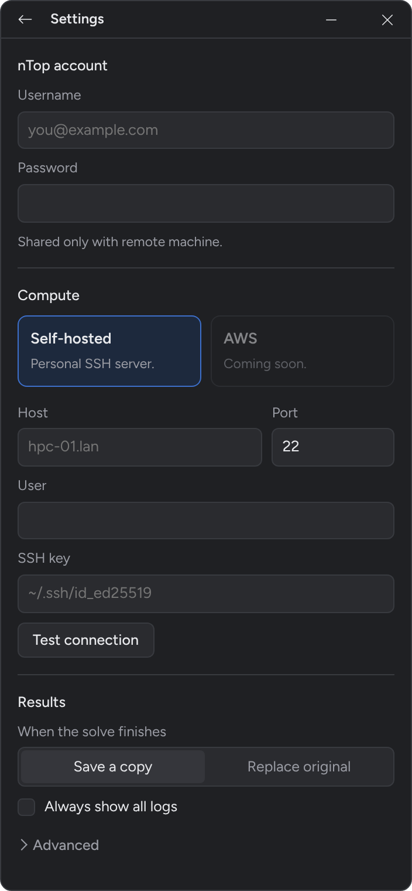

  <picture>
    <source media="(prefers-color-scheme: dark)" srcset="assets/logo-dark.svg">
    
  </picture>

    nAccelerate is an <u>unofficial</u> utility that connects cloud-compute to local <a href="https://www.ntop.com/" target="_blank" rel="noopener noreferrer">nTop</a> workflows for expedited iteration.

## Overview

nTop notebooks are a powerful engineering tool, but sometimes they can be slow—particularly if you're trying to do something like topology optimization on an older machine. Luckily, cloud compute is abundant and relatively cheap nowadays, so many of these expensive optimizations can be offloaded to a powerful server.

## Usage 

  <picture>
    
  </picture>

To run a noteboom:

1. Setup your HPC (see below).
2. Drag a folder containing your nTop notebook *and* any other referenced files into nAccelerate. 
3. Allocate the resources necessary by clicking on the cells.
4. Click "Send & Solve"

## Setup

> As of now, you must self-host your own server. However, if this project gains traction, I might add paid hosting.

  <picture>
    
  </picture>

To setup ntop:
1. Provide your nTop account credentials. These are never shared anywhere except to the server you connect. These are necessary to verify the headless license.
2. Fill in the server properties. As of now, this tool only accepts Linux servers.
3. Test the connection; this will verify the connection and determine the resources available.
  
Thats it!